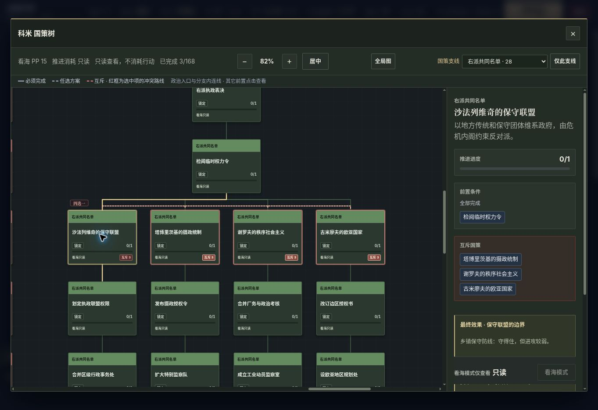
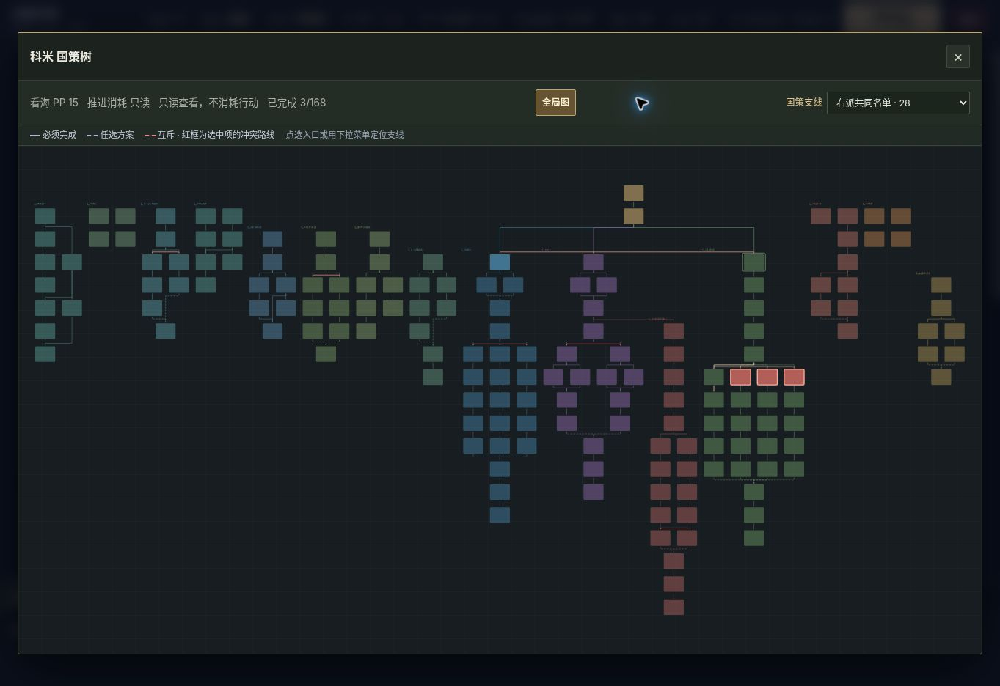

# 裂旗战争：国策终局效果与强度速查

更新：2026-11-11。本表列出美国与西俄罗斯每个政治落点的实际效果、主要打法和强度判断。本轮已经对原表的 50 个 B/C 落点逐项补强，以下数字均为补强后的结算值。

## 本轮改了什么

| 剧本 | 补强范围 | 调整后评级 |
| --- | --- | --- |
| 美国内战 | 原 14 个 B、1 个 C，共 15 个落点 | 25 个 S、60 个 A |
| 西俄罗斯 | 原 31 个 B、4 个 C，共 35 个终局 | 17 个 S、76 个 A |

**A 表示优势明确、能在正常统一对局中发挥；S 表示有更突出的资源或扩张循环。** 原 B/C 全部实际增加了效果后重新评为 A，没有仅更改字母。评级是基于实际结算规则的设计判断，不是实测胜率，也不意味着所有 A 线一样强。

守备线主要补地方税收、免维护名额与轮换能力；议会线补行政资源向建设、兵力的转换；强制动员线缓解军费和 PP 短板。进攻减益、昂贵征兵、高维护、低政治容量等代价仍保留。原有美国布局没有改动；西俄原 A/S 的制度与意识形态效果没有改动。

## 先看哪些路线

| 想玩的方向 | 美国内战 | 西俄罗斯 |
| --- | --- | --- |
| 连续攻占、越打越多兵 | 新英格兰克苏鲁、大德克萨斯（S） | 图哈切夫斯基纵深突击、高尔基突击兵团（A，军费较高） |
| 省心经营、用钱养军队 | 纽约金融共和国、德州石油财阀国（S） | 科米合作改革、沃洛格达地方粮食信用（S） |
| 大量操作与长期发展 | 社会民主联邦、奈亚拉托提普（S） | 科米开放政府、公共实验室（A） |
| 低成本防守后反击 | 贵格共同体、受保护共同体（A） | 战区联席、地方河防、白海守灯人（A） |
| 大规模动员 | 红色纽约公社（S）、边疆共和国（A） | 摄政统制、全国服务团（A，仍需控制军费） |
| 彩蛋与极端玩法 | 新英格兰三神方向（S） | 守灯人重港口供养；第零潮汐重占领回补（A） |

**广播彩蛋的变化：** 第零潮汐保留进攻 +50%、负防御和常态财政代价，但新增占领得钱 +6、免维护 10 兵。它现在能靠战果接续攻势，停战仍有压力。白海守灯人则补足港务收入和免维护，仍不擅长主动强攻。

## 数字口径

选择一条合法政治路径，只计算沿途持续奖励、最终意识形态，以及西俄罗斯最后生效的一套制度。共同政治收束章节计入；额外经济、军事项目和可选国家行动不计。任选前置只选一条最短合法来路；差异明显时列范围。改制后旧意识形态不会叠加，已经取得的普通永久国策效果会保留。

行动基础 PP 最低为 0，同回合行动递增仍会收取；每兵金钱成本最低 1、维护费率最低 0.05、PP 容量最低 20。不能把折扣继续相加理解成无限免费行动。西俄政治国策每项一次推进，美国部分国策需要推进 2—4 次；终局强度不等于相同回合的竞速表现。

## 西俄树为什么重新排

原西俄跨分支前置占约 20.3%，美国约 8.1%。问题不只在前置数量，还在于重复模板和跨区长线。此前把所有板块齐顶排成同款长列，虽然少了乱线，却丢掉了路线轮廓。

现在共同政治开局位于中央，根路线从会议分出，继承路线直接接在父路线大会旁；相邻政策并排，主干居中，真实的议会、并行内阁形成不同分叉与汇合。工业民政和军事外交在两翼。保留政治入口短连线，其它跨区项目通过可点击的前置名称说明；完整前置与互斥关系仍可查看。国策卡片继续用醒目的分支色块，取消每条路线外面的大块同款背景。

下面先列本次 50 项补强，再列全部 178 个落点的完整效果。

## 美国：15个原B/C落点补强

保留原布局、意识形态共享定义与路线前置。下表是终局节点新增的永久效果，按真实玩家引擎重新汇总；原A/S评级不变。

| 落点 | 评级 | 新增特色效果 | 重新评估 |
| --- | --- | --- | --- |
| 军队国家（usa_army_state） | B → A | 军需统筹：免维护+6、征兵额外+1、维护率−3个百分点。 | 进攻+30%配军需统筹，6免维护、征兵+1与低维护让常备军养得起；政治和现金仍较朴素。 |
| 美国赤军（CSA_american_red_army） | B → A | 统一军需：免维护+8、移动基础PP−1、每兵价差−1、PP/回合+1。 | 统一军需提供8免维护、低兵价与移动折扣，+35%进攻能持续兑现；改制仍会替换原政治意识形态。 |
| 神秘教团（AUS_esoteric_order） | B → A | 会众动员：免维护+4、征兵额外+2、防御+8%、PP/回合+1。 | 15免维护与征兵+2使会众能形成常备军，进攻+20%、防御+8%且PP供给改善；容量仍偏低。 |
| 神权统治（CON_ci_dominion） | B → A | 教区仓廪：钱/回合+2.5、免维护+6、每兵价差−1、维护率−2个百分点。 | 教区粮饷、8免维护和低兵价支撑防御+23%的持久战，进攻仍−5%，靠军费优势转入反击。 |
| 南方军事强人（CON_patton_caudillo） | B → A | 机动军需：移动基础PP−1、占领补兵+1、免维护+4、维护率−2个百分点。 | 进攻+20%、占领补1兵与移动折扣形成机动循环，4免维护降低停线压力；固定财政仍需建设。 |
| 利比里亚协定（CON_unia_liberia_pact） | B → A | 侨商补给：钱/回合+2、每兵价差−1、占领钱+3。 | 固定钱+5、每港口钱+3与便宜征募支撑海外补给，占领再得3钱；港口越多越强，PP容量仍小。 |
| 信仰国度（CON_noi_nation_state） | B → A | 自力更生：建设基础PP−1、钱/回合+2、PP/回合+1。 | 自力商社将钱/回合补到+3并节省建设PP，征兵+4、10免维护让动员可以持续；直接战力仍温和。 |
| 贵格共同体（NEN_quaker_commonwealth） | B → A | 互助账房：钱/回合+2、维护率−5个百分点、每兵价差−1。 | 钱/回合+2、维护率−7个百分点、低兵价与10免维护把和平互助变成军费优势；保留进攻−5%。 |
| 受保护共同体（NEN_shielded_commonwealth） | B → A | 协定供给：钱/回合+2、每港口钱/回合+1、免维护+5、每兵价差−1。 | 固定钱+3、每港口钱+2与8免维护让守港真正供养反击军；进攻−5%，主动战力依然保守。 |
| 新英格兰王冠（NEN_new_england_crown） | B → A | 王室特许：PP/回合+1.5、钱/回合+2、征兵额外+1、免维护+3。 | 王室特许带来固定钱+2、PP/回合+3和征兵+1，配大政治容量、每回合首都补兵，擅长稳定动员。 |
| 西部合众国（PAC_western_states） | C → A | 报业战争机器：钱/回合+4、PP/回合+1.5、移动基础PP−1、占领钱+2、PP上限+10。 | 报业机器补足财政与PP，钱/回合由−2转+2，占领得5钱、补1兵并有移动折扣；容量仍偏低。 |
| 太平洋灵性教团（PAC_spiritual_order） | B → A | 信徒军：征兵额外+2、PP/回合+1、进攻+10%、免维护+2。 | 信徒军补齐进攻+10%、征兵+2，PP/回合+4与12免维护支撑连续动员；优势在组织，不是极端战力。 |
| 司令部国家（WDC_command_state） | B → A | 分驻补给：免维护+4、PP/回合+1、维护率−4个百分点。 | 移动基础PP−1、PP/回合+2、10免维护与维护率−4个百分点支撑军区持续调度；经济成长仍依赖建设。 |
| 边疆共和国（WDC_frontier_republic_wdc） | B → A | 拓荒合作社：每兵价差−1、钱/回合+2、维护率−2个百分点。 | 征兵+6配低兵价、固定钱+2和9免维护，拓荒兵海更易兑现；政治容量仍小，需分批操作。 |
| 孤星收复主义（TEX_lone_star_irredenta） | B → A | 边境收复军：移动基础PP−1、占领补兵+1、免维护+4、每兵价差−1。 | 移动折扣、占领补2兵和4免维护强化边境收复军，油田收入与低兵价支撑推进；进攻倍率仍低于大德州。 |

可停留落点的新增永久修正会保留到后续改制：神秘教团 → 银色革命、利比里亚协定/信仰国度 → 黑带共和国/方舟。后续更换意识形态仍会移除旧意识形态自身加成。美国赤军是额外军事改制，也仍会替换原政治意识形态。

## 西俄：35 个原 B/C 终局补强

仅调整 33 个普通制度及 2 个彩蛋制度；没有改动原有 A/S 的制度、意识形态或沿途收益。没有新增国策前置、胜利条件或国家行动要求。评级是以统一扩张为目标的理论比较，仍需实战校准。

守备线补本土税收和可供养名额，议会线补建设或征募转换，强制动员线补基本军需和战果回收。仍保留各自进攻减益、昂贵征兵、高维护或低 PP。鞑靼地方河防按开局 6 个河港校准，将每港收益限定为 +0.4，避免防御线抢走贸易路线的财政优势。

40 兵示例：基础维护 $0.5，使用该国开局标签；表中财政改善是相对无修正 40 兵状态，包含标签收入、维护和免维护，不含占领、行动或额外经济国策。

| 结局 ID / 名称 | 评级 | 40兵财政改善 / 回合（前→后） | 调整后特色与代价 |
| --- | --- | --- | --- |
| `WRF_zhukov_0` / 代表优先的北方共和国 | B→A | $+3.10 → $+6.35 | 铁路每省收入提高到0.5，建设PP−1与3个免维护名额让高PP可转成工业和守军；仍有进攻−14%。 |
| `WRF_tukhachevsky_1` / 总参掌管每一袋粮 | B→A | $+1.47 → $+5.58 | 征兵+3、免维护11兵，PP增益提高到0.95，维护降至0.53；总参能维持大批补员，但不擅长极限突击。 |
| `WRF_continuity_0` / 两个战区的共同防线 | B→A | $+3.55 → $+5.98 | 防御+36%与林铁地形继续专精防线，新增征兵+1、9个免维护名额和0.47维护支持守转攻；进攻仍−9%。 |
| `WRF_cadres_0` / 军校接管战争 | B→A | $+3.55 → $+5.35 | 便宜0.5的兵价、征兵+1、移动PP−1组成军校轮训体系，防御仍+36%；进攻−9%与继承链长度仍是代价。 |
| `KOM_centre_1` / 有失效日期的紧急权力 | B→A | $+1.37 → $+5.21 | 紧急预备队享有8个免维护名额、征兵PP−1，防御+22%可以配上实际兵力；进攻没有突出倍率。 |
| `KOM_left_0` / 党部与战区同一张表 | B→A | $+0.57 → $+2.99 | 进攻+17%、防御+10%、征兵+2，新增PP、供养名额和占领得钱，让党军动员有持续行动能力；政治容量仍较小。 |
| `KOM_right_0` / 保守联盟的边界 | B→A | $+2.85 → $+5.67 | 防御+36%、7个免维护名额与0.475维护能供养乡镇防线；兵价仍+0.35，扩军依然昂贵。 |
| `KOM_right_1` / 停在午夜的摄政钟 | C→A | $-5.65 → $+3.20 | 保留征兵+7和防御−4%的极端动员，新增10个免维护名额，固定赤字与PP亏损得到缓解；0.565维护仍要求控制规模。 |
| `KOM_right_2` / 工号代替姓名 | B→A | $+1.25 → $+3.05 | 工厂收入和征兵PP折扣让统制工业更容易支撑动员，维护降至0.545；PP额外收益仍为−0.55，需集中操作。 |
| `VYA_kadets_1` / 慢一步的立宪 | B→A | $+4.45 → $+6.95 | 8个免维护名额、固定钱+2.95和PP+1.25支持过渡政府逐步扩军；每兵仍贵0.55。 |
| `VYA_shulgin_0` / 王冠与各省的契约 | B→A | $+2.95 → $+5.45 | 森林每省额外收入0.8、免维护5兵、征兵+1，让省税自治同时供给行政和兵力；进攻仍−7%。 |
| `VYA_solidarists_1` / 全国服务团 | C→A | $-3.25 → $+4.40 | 社团征兵仍+4，新增6个免维护名额、工业收入和PP，维护由0.615降至0.575；大军仍比常规路线贵。 |
| `VYA_rovs_0` / 近卫将岗哨交给杜马 | B→A | $+2.85 → $+5.67 | 防御+36%、7个免维护名额配合占领补1兵，守军能积累反击力量；进攻仍−12%，不适合无脑硬推。 |
| `SAM_zykov_0` / 伏尔加军队接受追问 | B→A | $+1.35 → $+5.75 | 保留高PP与问责特色，铁路收入、建设折扣和免维护4兵让行政转化为后勤；进攻仍−14%。 |
| `SAM_oktan_1` / 二十年后仍要付款 | B→A | $+3.25 → $+5.81 | 缴获+7与征兵+2不变，降低兵价和维护、给3个免维护名额，垄断军需能自己供养军队；PP额外收入仍−0.75。 |
| `SAM_officers_0` / 蓝灯下的桥头防线 | B→A | $+4.14 → $+8.04 | 河港收入、免维护6兵和移动PP−1支撑防线轮换，河港防御最高+58%；进攻仍−18%。 |
| `PRM_vagner_0` / 警备队站在每道门前 | C→A | $-5.05 → $+2.85 | 廉价征兵+6配上10个免维护名额与缴获+4，警备军可真正展开；PP几乎无额外增长，维护0.57依旧昂贵。 |
| `PRM_velimir_0` / 极北神话的代价 | C→A | $-5.45 → $+2.35 | 进攻+22%、征兵+6增加占领补1兵与4钱，10个免维护名额缓和开局军费；固定收入仍略负，必须主动争取战果。 |
| `PRM_velimir_1` / 只保留工号的行政区 | B→A | $+1.05 → $+5.58 | 工厂每省收入增至1.1，征兵+4、免维护3兵与更低维护把工矿变成动员来源；政治容量仍受压。 |
| `PRM_engineers_1` / 钥匙交给每一个城区 | B→A | $+4.14 → $+7.64 | 工厂收入、建设折扣和免维护6兵让城区互保可持续扩产；防御+36%但进攻仍−18%。 |
| `ONE_treaty_0` / 北境大门上的两把锁 | B→A | $+4.54 → $+8.06 | 港口收入和免维护7兵支持高防御协约，40兵示例财政改善约8.06；进攻−18%，离港扩张并不快。 |
| `ONE_autonomy_0` / 沿湖城镇自己的灯火 | B→A | $+1.80 → $+5.10 | 港口税收、免维护5兵与征兵+1补齐小国自治的供给，高PP有实际转化目标；进攻仍−14%。 |
| `ONE_autonomy_1` / 不向任何一边借道 | B→A | $+5.78 → $+9.11 | 防御+51%不变，维护0.42、免维护8兵和额外财政让中立军真正养得起；进攻−34%仍是明确短板。 |
| `ONE_zero_sealed` / 白海守灯人 | B→A | $+3.60 → $+7.30 | 港口收入提高到2，免维护5兵和0.42维护支撑守灯人防线；防御+35%，进攻仍−32%。 |
| `ONE_zero_broadcast` / 第零潮汐共同体 | B→A | $-8.40 → $+1.10 | 进攻+50%、占领补2兵再得6钱，10个免维护名额避免立刻被援军拖垮；固定钱−3、PP−0.8，停战仍有压力。 |
| `GOR_armor_1` / 坦克作为移动堡垒 | B→A | $+4.14 → $+5.78 | 移动PP折扣、征兵+1和免维护5兵强化移动堡垒；进攻减益收窄至−4%，防御仍+36%，兵价仍贵。 |
| `GOR_veterans_0` / 老兵把领条换成合同 | B→A | $+5.25 → $+7.55 | 退伍合同提供免维护8兵、固定钱+3.55和征兵+1，恢复经济可以支持后备军；进攻仍−12%。 |
| `VOL_schools_0` / 每座车站旁都有学堂 | B→A | $+1.35 → $+5.35 | 铁路学堂带来每省0.6收入、征兵+1和低维护，高PP与国策折扣开始转化为供给；进攻仍−14%。 |
| `VOL_neutrality_0` / 军车等候的六分钟 | B→A | $+4.14 → $+8.79 | 铁路税收、免维护6兵和移动PP−1组成通行权防务，守铁路兼顾军费；进攻仍−18%。 |
| `GEO_parishes_1` / 救济窗口不再询问信仰 | B→A | $+1.80 → $+6.17 | 无差别救济增加5个免维护名额、财政与低维护，让高PP民政可以养兵；进攻仍−14%。 |
| `GEO_order_0` / 白线标出的桥梁 | B→A | $+3.77 → $+7.90 | 河港税收和免维护7兵使高防御桥梁网络有稳定军费；0.45维护便宜，但进攻仍−18%。 |
| `GEO_law_0` / 地契保存在法院 | B→A | $+1.35 → $+5.35 | 地契林税与征兵PP−1让法院收入支持动员，高政治容量更好用；建设PP加价与进攻−14%保留。 |
| `TAT_guard_0` / 把最后一条船留给村庄 | B→A | $+4.14 → $+8.90 | 河港收入、免维护7兵与0.45维护支持地方河防，防御+40%另叠河港19%；进攻仍−18%。 |
| `BSH_home_0` / 村名后面都有一个姓名 | B→A | $+1.95 → $+5.15 | 粮区每省收入0.6、免维护4兵和征兵+1让多村自治能供给共同卫队；高PP仍伴随进攻−14%。 |
| `BSH_mountains_0` / 备用炉门等候撤回的人 | B→A | $+4.14 → $+8.03 | 山地收入、免维护7兵和0.44维护支持纵深守备，山地防御最高+55%；进攻仍−18%。 |

验证：93 个结局通过真实 App.applyFocusEffect 与玩家经济／军事 getter 一致性核对；新增回归测试遍历 35 条最短合法政治路线，确认实际供养能力均有改善；原 58 个 A/S 的累计效果与制度包逐项完全相同。

## 数据来源与验证

- 数值与布局源码快照：[CLRedfield/AmericaWar · 0303746](https://github.com/CLRedfield/AmericaWar/tree/0303746f55fb997cd6403c789275e16e170fb1cc)。
- 美国：`js/focus-trees/data/*.js`、`js/focus-trees.js`、`js/state.js`。
- 西俄罗斯：`js/scenarios/west-russia-endings.js`、`west-russia-focus.js`、`west-russia.js`、`west-russia-secrets.js`。
- 真实结算：`js/app.js`、`js/state.js` 与同时回合结算代码。
- 美国 85 条代表路径和西俄 93 个终局均送入真实玩家效果引擎，对照攻防、收入、维护、征募、占领回补与行动折扣，178 项均匹配。66 项自动检查通过，包含原美国树结构保留、西俄节点/连线几何、互斥与路线补强。
- 浏览器实际检查了革命阵线、科米的局部政治树与完整轮廓，确认四名候选人并排、互斥提示可见。

美国 85 项包括 77 个普通政治终局候选、7 个可停留的中途政体和 1 个军事改制；西俄为 91 个普通终局与 2 个彩蛋。合计 178 个政体落点，不等于 178 条完全独立的政治分叉，也没有声称完成 178 局胜率测试。

## 浏览器验收画面

科米四名候选人并排，选中一名后，其余三名显示互斥：

完整树轮廓：中央政治主干，经济民政和军事外交分布两翼：

